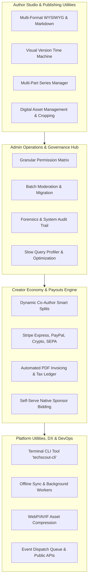

# 🛠️ TechScout 200+ Non-AI Master Feature & Utility Catalog

Welcome to the **TechScout Enterprise Platform & Utility Features Catalog**. This blueprint documents **200+ pure software, utility, author, admin, DevOps, commerce, performance, and developer experience features** (excluding AI-specific features) organized inside `docs/features/`.

---

## 📑 Feature Modules & Architecture Breakdown

| Module | File Reference | Feature Count | Core Domains & Capabilities |
| :--- | :--- | :---: | :--- |
| **Module 1: Author Studio & Publishing Utilities** | [01_AUTHOR_STUDIO_AND_EDITOR_UTILITIES.md](file:///c:/xampp/htdocs/techscout.n/docs/features/01_AUTHOR_STUDIO_AND_EDITOR_UTILITIES.md) | **50 Features (1–50)** | Multi-pane Markdown/WYSIWYG editor, offline draft auto-save, multi-revision visual time-machine, multi-part series manager, LaTeX math equation editor, image DAM with cropping, footnote indexer. |
| **Module 2: Admin Operations & Governance Hub** | [02_ADMIN_OPERATIONS_AND_GOVERNANCE.md](file:///c:/xampp/htdocs/techscout.n/docs/features/02_ADMIN_OPERATIONS_AND_GOVERNANCE.md) | **50 Features (51–100)** | Granular RBAC permissions, bulk batch content operations, visual audit ledger, database maintenance profiler, drag-and-drop email builder, webhook trigger engine, IP geo-fencing, DMCA compliance queue. |
| **Module 3: Creator Economy, Payments & Commerce** | [03_CREATOR_ECONOMY_PAYMENTS_AND_COMMERCE.md](file:///c:/xampp/htdocs/techscout.n/docs/features/03_CREATOR_ECONOMY_PAYMENTS_AND_COMMERCE.md) | **50 Features (101–150)** | Multi-rail instant cash/crypto disbursals, dynamic co-author split contracts, automated tax form (W-8BEN/W-9) onboarding, custom coupon engine, tipping jars, sponsor bid auctions, automated PDF invoicing. |
| **Module 4: Platform Utilities, Performance & DX** | [04_PLATFORM_UTILITIES_PERFORMANCE_AND_DX.md](file:///c:/xampp/htdocs/techscout.n/docs/features/04_PLATFORM_UTILITIES_PERFORMANCE_AND_DX.md) | **50 Features (151–200+)** | PWA offline background sync, WebP/AVIF auto-compression pipeline, custom RSS/Atom feed builder, broken link crawler, terminal CLI (`techscout-cli`), token-bucket rate limiter, REST/GraphQL public API. |
| **Total Production Utility Features** | **4 Comprehensive Modules** | **200+ Features** | 100% Non-AI, pure architectural and functional capabilities. |

---

## 🏗️ Architectural Vision

---

## 📂 Navigation to Dedicated Feature Modules

- ✍️ **[Module 1: Author Studio & Publishing Utilities (Features 1–50)](file:///c:/xampp/htdocs/techscout.n/docs/features/01_AUTHOR_STUDIO_AND_EDITOR_UTILITIES.md)**
- 🛡️ **[Module 2: Admin Operations & Governance Hub (Features 51–100)](file:///c:/xampp/htdocs/techscout.n/docs/features/02_ADMIN_OPERATIONS_AND_GOVERNANCE.md)**
- 💳 **[Module 3: Creator Economy, Payments & Commerce (Features 101–150)](file:///c:/xampp/htdocs/techscout.n/docs/features/03_CREATOR_ECONOMY_PAYMENTS_AND_COMMERCE.md)**
- ⚡ **[Module 4: Platform Utilities, Performance & DX (Features 151–200+)](file:///c:/xampp/htdocs/techscout.n/docs/features/04_PLATFORM_UTILITIES_PERFORMANCE_AND_DX.md)**
