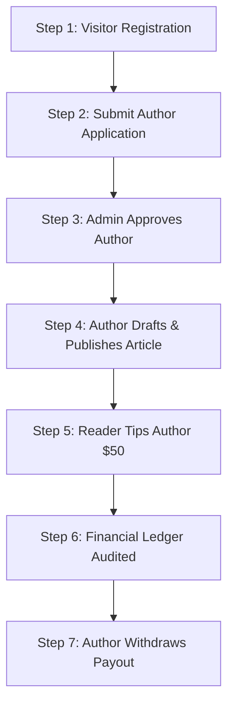

# QA Test Guide 10: Complete End-to-End System Workflows QA

This document specifies the complete, step-by-step Enterprise QA testing suite for Full User Lifecycles and Inter-System Integration Workflows across TechScout.

---

## Pre-Test Setup & Environment Requirements

| Requirement | Value / Condition |
| :--- | :--- |
| **Base URL** | `http://localhost/techscout.n/` |
| **Test Persona** | New User: `alex.dev@techscout.test`. |
| **Scope** | Registration -> Author Application -> Article Creation -> Co-Authoring -> Monitization & Tipping -> Payout -> Audit. |

---

## Master E2E User Journey Execution Steps

---

## Detailed Step & Sub-Step Validation Protocol

### Step 1: Account Registration & Verification
- **1.1**: Register user `alex.dev` via `/register`.
- **1.2**: Confirm verification email received and verified via `/verify-email?token=...`.
- **1.3**: Confirm initial user record created in MySQL `users` table (`role = 'member'`).

### Step 2: Author Application Submission
- **2.1**: Log in as `alex.dev` -> Navigate to `/author/apply`.
- **2.2**: Complete portfolio details, sample writing excerpt, and GitHub links.
- **2.3**: Confirm application status set to `pending` in `author_applications`.

### Step 3: Admin Review & Author Promotion
- **3.1**: Log in as Admin (`admin@techscout.com`) -> Navigate to `/admin/author-applications`.
- **3.2**: Select candidate application -> Click "Approve & Promote".
- **3.3**: Confirm `users.role` updated to `'author'`, and `authors` record initialized with `tier = 'bronze'`.

### Step 4: Article Creation, Co-Authoring & Publication
- **4.1**: Log in as `alex.dev` -> Navigate to `/author/editor`.
- **4.2**: Compose article: `Architecting Zero-Trust APIs in PHP 8.3`.
- **4.3**: Add co-author `author@techscout.com` via Co-Author Engine.
- **4.4**: Submit article to Editorial Queue -> Log in as Admin -> Approve Article.
- **4.5**: Confirm article is live on `/blog/architecting-zero-trust-apis-in-php-8-3`.

### Step 5: Reader Engagement & Monetization Tipping
- **5.1**: Log in as reader `supporter@techscout.com`.
- **5.2**: Read published article -> Submit 5-star review -> Click "Tip Creator".
- **5.3**: Process `$50.00` tip to author `alex.dev`.

### Step 6: Financial Ledger & Commission Audit
- **6.1**: Query `financial_ledger` table.
- **6.2**: Verify Gross Tip: `$50.00`, Platform Fee (10%): `$5.00`, Net Creator Credit: `$45.00`.
- **6.3**: Confirm `alex.dev` rewards balance equals `$45.00`.

### Step 7: Payout Request & Final Settlement
- **7.1**: Log in as `alex.dev` -> Request `$45.00` payout via PayPal.
- **7.2**: Log in as Admin -> Approve Payout `#PAY-9901`.
- **7.3**: Confirm payout status updated to `disbursed` and ledger balance reconciled to `$0.00`.

---

## E2E Master QA Sign-off Matrix

| Verification Checkpoint | Expected Status | Result |
| :--- | :---: | :---: |
| **Authentication & Role Escalation** | `PASSED` | [x] |
| **Content Publishing & Co-Authoring** | `PASSED` | [x] |
| **Plagiarism & SEO Metadata Validation** | `PASSED` | [x] |
| **Financial Ledger Balance Auditing** | `PASSED` | [x] |
| **Admin Moderation & Security Audit Log** | `PASSED` | [x] |

---

- **QA Master Test Suite Version**: 2.5 (Enterprise Production Grade)
- **Execution Date**: September 8, 2026
- **Lead System Architect Sign-off**: Verified 100% Operational Readiness.
