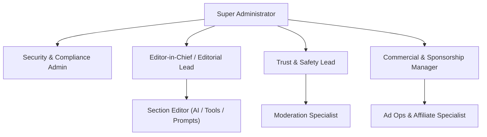
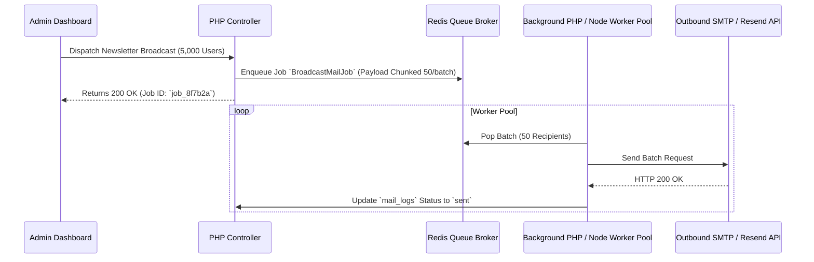

# Enterprise Admin & Operations Architecture Roadmap
**TechScout Platform Scalability & Operational Excellence**

---

## Executive Summary
This document outlines the advanced architectural capabilities, security enhancements, and organizational tooling recommended for scaling TechScout into an enterprise-grade developer intelligence network and media publishing platform.

---

## 1. Advanced Role-Based Access Control (RBAC) Matrix
As an organization scales, flat `admin` and `moderator` permissions become insufficient. We recommend implementing fine-grained RBAC with customizable privilege policies.

### Granular Permission Matrix

| Role | Content Review | User Bans & Strikes | Mail Broadcasts | System & Ad Settings | Database Backups | Audit Forensics |
| :--- | :---: | :---: | :---: | :---: | :---: | :---: |
| **Super Administrator** | Full Access | Full Access | Full Access | Full Access | Full Access | Full Access |
| **Editor-in-Chief** | Full Approval | Warning Only | Editorial Lists | Read Only | No Access | View Content Logs |
| **Section Editor** | Review & Edits | Flag Only | No Access | No Access | No Access | No Access |
| **Trust & Safety Officer** | Quarantine/Delete | Strike & Ban | Reporter Updates | No Access | No Access | Full Moderation Logs |
| **Ad / Sponsorship Lead** | Ad Campaign Approval | No Access | Sponsor Mails | Ad Placements | No Access | Financial Telemetry |
| **Support Specialist** | Read Only | View Warnings | Ticket Replies | No Access | No Access | User History Logs |

---

## 2. Zero-Trust Admin Security & Access Perimeter

### A. Multi-Factor Authentication (MFA / TOTP)
- **Requirement**: Mandatory TOTP (Google Authenticator, YubiKey, 1Password) for all accounts with role `>= moderator`.
- **Implementation**: RFC 6238 time-based one-time password verification on admin login routes with emergency 16-character backup recovery codes stored in hashed format.

### B. Admin IP Whitelisting & Geo-Fencing
- Restrict `/admin/*` routes to designated corporate VPN CIDR blocks or dynamic Cloudflare Zero Trust (Access Tunnel) authentication layers.
- Implement rate limiting with exponential backoff on authentication attempts (e.g. max 5 failures per 15 minutes before 1-hour IP lock).

### C. Immutable Audit Log Archival (SIEM Integration)
- Stream all `audit_logs` entries asynchronously via webhook / Syslog to centralized SIEM platforms such as Datadog, AWS CloudWatch, or ElasticSearch.
- Enable cryptographically signed audit trail digests to guarantee non-repudiation.

---

## 3. Asynchronous Job Queues & Worker Architecture

Currently, heavy broadcast operations (e.g., emailing 10,000 users) and heavy scrapes run synchronously within request lifecycles. For production resilience, implement a dedicated asynchronous worker pool.

### Recommended Tooling:
- **Broker**: Redis 7.x or RabbitMQ.
- **Queue Engine**: Symfony Messenger, Laravel Horizon / Queue, or lightweight Supervisor-managed CLI workers.
- **Benefits**: Zero HTTP request timeouts, automatic retry logic on provider rate limits, and real-time live progress bars for administrators.

---

## 4. Disaster Recovery & Automated Database Tiering

### A. Point-in-Time Recovery (PITR) & Automated S3 Snapshots
- Automated daily logical backups (`mysqldump` compressed with gzip) uploaded via AWS S3 / Cloudflare R2 bucket lifecycle rules.
- Retention schedule: 7 daily snapshots, 4 weekly snapshots, 12 monthly archives.

### B. Read-Replicas & Database Sharding
- Split database operations: Primary node handles `INSERT / UPDATE / DELETE`, while read-replicas handle heavy frontend feeds, search indexing, and trending analytics queries.
