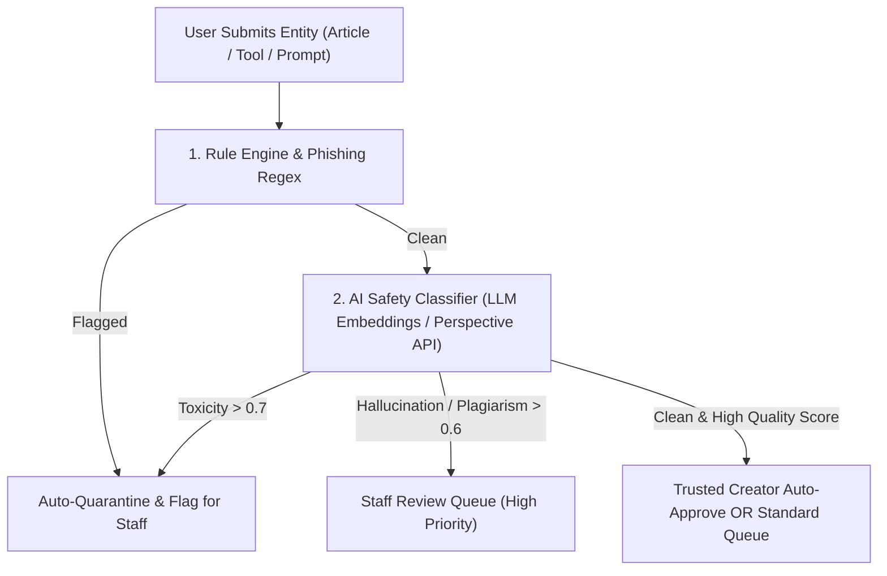

# Trust, Safety & Community Moderation Scaling Framework
**Automated Threat Mitigation, AI Content Screening & Progressive Sanctions**

---

## 1. AI-Powered Pre-Moderation Pipeline

To handle high volumes of submissions (articles, AI tools, prompts, comments, and creator bios) without manual backlog bottlenecks, implement an automated multi-stage AI classification gateway before content reaches staff review.

### Screening Criteria & Automated Thresholds:
1. **Malicious URLs & Domain Reputation**: Check embedded external links against Google Safe Browsing API and VirusTotal URL feed.
2. **Plagiarism & Code Authenticity**: Compute MinHash similarity against existing tech articles and GitHub repositories.
3. **Prompt Injection & Adversarial Payloads**: Scan prompt listings for jailbreak injections, system bypass strings, and unauthorized scraping instructions.

---

## 2. Progressive Tiered Sanctions & Strike Escalation Engine

To provide clear policy enforcement and reduce repeated infractions, implement a standardized 4-tier strike penalty policy:

| Strike Level | Account Restrictions | Creator Publishing Status | Duration | Automatic Action |
| :--- | :--- | :--- | :--- | :--- |
| **Strike 1: Warning** | Formal email notice & dashboard banner | Normal publishing | 30-Day Expiry | Required acknowledgment before submitting new content |
| **Strike 2: Cooldown** | Disabled comments & reactions | Content queue requires senior editor review | 14 Days | Promo credits frozen |
| **Strike 3: Suspension** | Login permitted in read-only mode | Publishing revoked across all categories | 30 Days | Profile unlisted from public creator directory |
| **Strike 4: Permanent Ban** | Complete account deactivation & session revocation | Permanent revocation | Permanent | Associated domain/email hashed & added to blacklist |

---

## 3. Author Reputation & Trust Scoring Algorithm (Karma Engine)

Calculate a dynamic **Trust & Quality Score ($T_s$)** for every author based on platform history:

$$T_s = \left( \frac{A_p}{A_t} \times 40 \right) + \left( \min(\text{Upvotes}, 1000) \times 0.03 \right) - (\text{Strikes} \times 25) + (\text{Age}_{\text{months}} \times 2)$$

- $A_p$: Approved Publications
- $A_t$: Total Submissions
- Authors with $T_s \ge 85$ and 0 active strikes unlock **Fast-Track Auto-Publishing** for minor article updates and tool listings.
- Authors with $T_s < 40$ are routed to mandatory pre-screening queues.

---

## 4. Author Appeals & Dispute Resolution Lifecycle

1. When an entity is deleted or a strike is issued, the creator receives a structured notification containing the exact violated policy clause and administrative notes.
2. The user can submit a **One-Click Appeal** with clarifying evidence or corrected source links within 14 days.
3. Appeals are routed to an independent moderator (different from the original reviewer) with an SLA target of `< 48 hours`.
