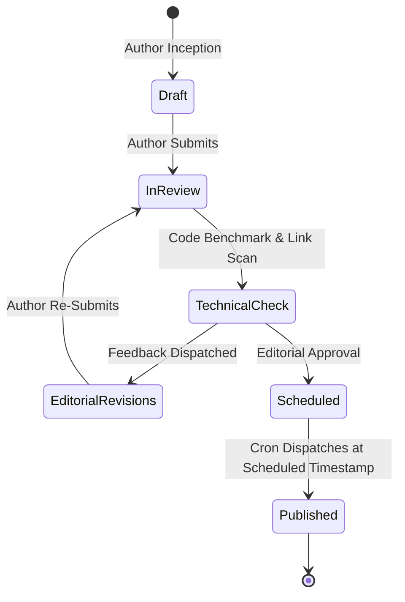

# Editorial Pipeline & Creator Economy Architecture
**Advanced Content Lifecycle, Multi-Stage Kanban, Collaborative Editing & Monetization**

---

## 1. Multi-Stage Editorial Kanban Pipeline

To support high-velocity publishing alongside strict technical verification, upgrade the editorial queue to a 5-stage collaborative workflow:



### Stage Responsibilities:
1. **Draft Stage**: Author drafts content with auto-saving, Markdown live preview, syntax highlighting, and media uploading.
2. **Technical Check Stage**: Staff checks code blocks for executable correctness, benchmark validity, and license compliance.
3. **Editorial Revisions Stage**: Staff uses inline feedback comments to request revisions without rejecting the entire submission.
4. **Scheduled Stage**: Set publication date & timezone for simultaneous social broadcast.

---

## 2. Automated SEO & Structured Schema Engine

Every published article and directory listing should automatically generate rich JSON-LD Schema structured data to capture top Google search rankings:

```json
{
  "@context": "https://schema.org",
  "@type": "TechArticle",
  "headline": "Building High-Throughput Microservices in Go & Rust",
  "image": "https://techscout.online/uploads/covers/go_rust_perf.webp",
  "author": {
    "@type": "Person",
    "name": "Sarah Jenkins",
    "url": "https://techscout.online/author/sarah-jenkins"
  },
  "publisher": {
    "@type": "Organization",
    "name": "TechScout",
    "logo": {
      "@type": "ImageObject",
      "url": "https://techscout.online/assets/img/logo.png"
    }
  },
  "datePublished": "2026-08-29T18:00:00+05:00",
  "dateModified": "2026-08-29T18:30:00+05:00"
}
```

### Automated Checks:
- **Readability Index**: Compute Flesch-Kincaid grade level.
- **Canonical Consistency**: Automatic enforcement of canonical tags across parameterized search and filter URLs.
- **OpenGraph & Twitter Card Preview**: Live visual card preview generator in the editor.

---

## 3. Creator Monetization & Revenue Distribution Engine

### Recommended Revenue Models:
1. **Ad Revenue Share (RPM Model)**: Authors receive a monthly payout based on impression share generated by verified readers on their articles.
2. **Developer Challenge Bounties**: Companies sponsor hackathons and engineering challenges with prize pools directly distributed to winning creators.
3. **Prompt & Tool Sponsorships**: Verified creators can feature their proprietary tools or prompts with platform promotional credits.
