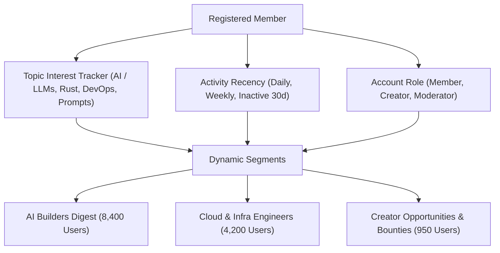
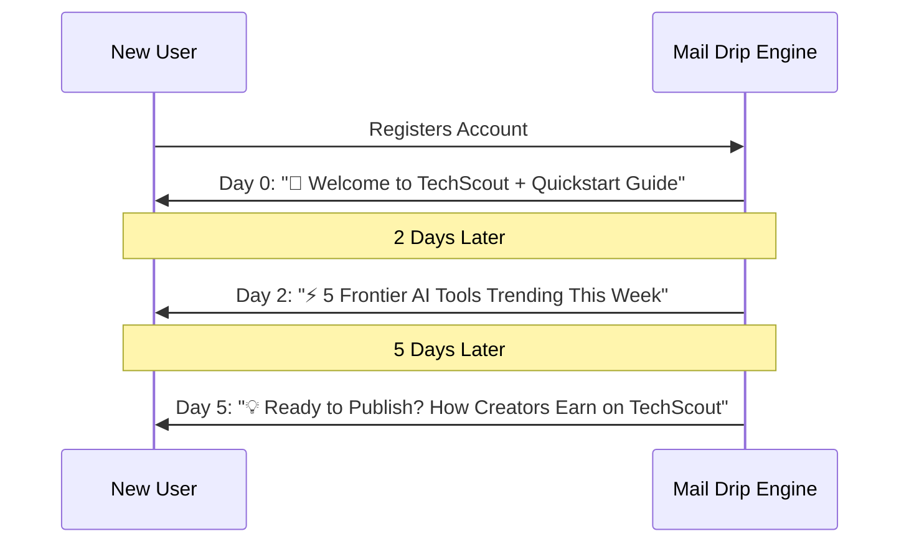

# Newsletter, CRM & Growth Marketing Engine
**Audience Segmentation, Drip Automation, A/B Testing & Deliverability Standards**

---

## 1. Dynamic Audience Segmentation & Topic Tagging

Rather than sending generic broadcasts to all users, implement behavioral and interest-based audience segmentation to maximize open rates ($>40\%$) and click-through rates ($>12\%$).

---

## 2. Automated Drip Email Sequences (Lifecycle Marketing)

Implement multi-touch automated email workflows triggered by platform milestones:

---

## 3. A/B Subject Line & Content Variant Testing

Allow admins to test two subject lines or CTA buttons on a representative sample before full release:
1. **Sample Phase**: Send Variant A to 10% of audience, Variant B to 10% of audience.
2. **Evaluation Window**: Wait 2 hours; evaluate open rate & CTR.
3. **Winner Broadcast**: Automatically deliver the winning variant to the remaining 80% of recipients.

---

## 4. Email Deliverability & Anti-Spam Compliance

Ensure 100% inbox placement and prevent spam folder routing:
- **DNS Records**: Full SPF (`v=spf1 include:... ~all`), DKIM (`2048-bit RSA`), and DMARC (`p=reject; rua=mailto:...`) configuration.
- **List-Unsubscribe Headers**: Native RFC 8058 One-Click Unsubscribe headers in every outgoing transaction.
- **Automated Bounce & Complaint Handling**: Webhook listener receiving hard-bounce events from Resend / SendGrid and automatically marking target email `inactive`.
