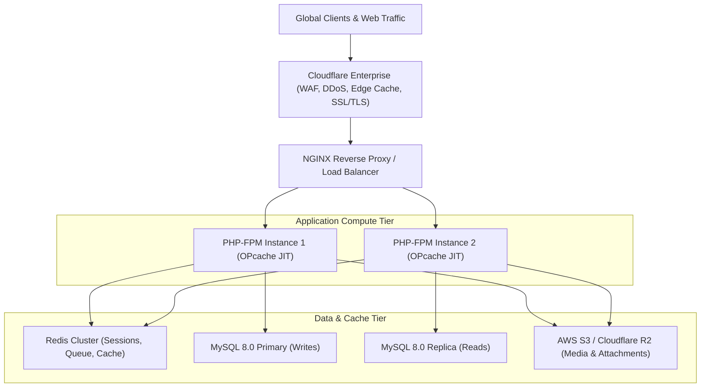

# Enterprise Infrastructure, Security & DevOps Guide
**High-Availability Deployment, WAF Hardening, Caching Tiers & CI/CD Pipelines**

---

## 1. High-Availability Multi-Tier Production Architecture



---

## 2. Web Application Firewall (WAF) & HTTP Hardening

Implement strict HTTP security headers in production NGINX / Apache configuration:

```nginx
# Security Headers
add_header X-Frame-Options "SAMEORIGIN" always;
add_header X-Content-Type-Options "nosniff" always;
add_header X-XSS-Protection "1; mode=block" always;
add_header Referrer-Policy "strict-origin-when-cross-origin" always;
add_header Permissions-Policy "camera=(), microphone=(), geolocation=()" always;
add_header Content-Security-Policy "default-src 'self'; script-src 'self' 'unsafe-inline' https://cdn.jsdelivr.net https://pagead2.googlesyndication.com; img-src 'self' data: https:; style-src 'self' 'unsafe-inline' https://fonts.googleapis.com; font-src 'self' https://fonts.gstatic.com;" always;
```

---

## 3. Multi-Layer Caching Strategy

1. **Edge Cache (Cloudflare / Fastly)**:
   - Cache static assets (CSS, JS, SVG, WebP) with `Cache-Control: public, max-age=31536000, immutable`.
   - Micro-cache public articles (`Cache-Control: public, s-maxage=300, stale-while-revalidate=60`).
2. **In-Memory Application Cache (Redis)**:
   - Cache expensive aggregation queries (trending articles, homepage stat counters, category tools count) with 5-minute TTL.
3. **Database OPcache**:
   - Enable PHP OPcache with `opcache.enable=1`, `opcache.memory_consumption=256`, and `opcache.jit=1255` for high-throughput execution.

---

## 4. Automated CI/CD Pipeline & Health Checks

- **Health Endpoint (`/healthz`)**: Returns JSON payload with database ping latency, Redis connectivity, and disk usage:
  ```json
  {
    "status": "healthy",
    "timestamp": "2026-08-29T18:50:00Z",
    "database": { "status": "connected", "latency_ms": 1.2 },
    "cache": { "status": "connected" },
    "disk_free_gb": 48.2
  }
  ```
- **Automated Smoke Tests**: Run PHPUnit test suites, PHP lint checks (`php -l`), and static analysis (PHPStan / Psalm) on every GitHub pull request before automated staging deployment.
