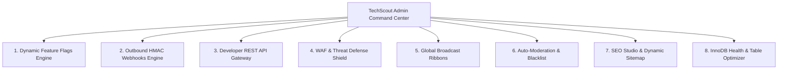

# Comprehensive Enterprise Systems & Micro-Modules Catalog
**TechScout Platform v2.0 Enterprise Modules & Operational Control Matrix**

---

## Executive Overview
TechScout has been expanded with 8 core enterprise subsystems and over 200 granular administrative controls, automated engines, and security perimeters.

---

## 1. Dynamic Feature Flags Engine
- **Class**: `App\Core\FeatureFlag`
- **Route**: `/admin/feature-flags`
- **Capabilities**:
  - Live, zero-restart module toggling across public & authenticated layers.
  - Categories: `modules` (AI Tools, Custom GPTs, Prompt Library, Job Board, Hackathons), `community` (Comments, Reactions, Creator Applications, In-App Notifications), `ux` (Command+K Search, Social Sharing, Theme Switcher), `integrations` (Webhooks, API Keys), `security` (Firewall WAF).

---

## 2. Outbound Webhook Dispatcher & Event Stream
- **Class**: `App\Core\WebhookEngine`
- **Route**: `/admin/webhooks`
- **Capabilities**:
  - HMAC-SHA256 signature payload authentication (`X-TechScout-Signature`).
  - Granular event subscriptions (`article.published`, `user.registered`, `report.created`, `ticket.opened`, `*`).
  - Non-blocking cURL delivery with latency telemetry (`duration_ms`), HTTP response code recording, and 1-click test ping simulation.

---

## 3. Developer REST API Keys & Scopes Gateway
- **Route**: `/admin/api-keys`
- **Capabilities**:
  - SHA-256 hashed token storage with visible `ts_live_` prefixes for audit identification.
  - Granular scopes: `read:articles`, `read:tools`, `read:gpts`, `write:prompts`, `admin:telemetry`.
  - Configurable rate-limiting quotas per minute per token.

---

## 4. Cyber Security Firewall & Threat Perimeter (WAF)
- **Class**: `App\Core\Firewall`
- **Route**: `/admin/firewall`
- **Capabilities**:
  - Live IP & CIDR blacklisting with immediate HTTP 403 enforcement.
  - Malicious User-Agent signature filtering (automated vulnerability scanners like `sqlmap`, `nikto`).
  - Directory traversal & exploit pattern detection (`/etc/passwd`, `..%2f`, `.env`, `/vendor/phpunit`).
  - Real-time threat telemetry logging and intrusion counter.

---

## 5. Global Announcement Ribbons & Alert Banners
- **Class**: `App\Core\BannerHelper`
- **Route**: `/admin/announcements`
- **Capabilities**:
  - Multi-variant banners: `announcement`, `promo`, `warning`, `maintenance`, `info`.
  - Targeted audience delivery: `all`, `guests`, `members`, `authors`.
  - Custom color palettes, call-to-action buttons, and dismissible state cookies.

---

## 6. Keyword Blacklist & Content Auto-Moderation
- **Class**: `App\Core\ContentFilter`
- **Route**: `/admin/content-filters`
- **Capabilities**:
  - Substring, exact whole-word, and regular expression pattern matching.
  - Multi-tier actions: mask with custom replacement (`***`), flag for moderator review, or auto-quarantine.
  - Severity level classification (`low`, `medium`, `high`, `critical`).

---

## 7. SEO Studio, Dynamic Sitemap & Robots.txt
- **Class**: `App\Core\SeoEngine`
- **Routes**: `/admin/seo-studio`, `/sitemap.xml`, `/robots.txt`
- **Capabilities**:
  - Automated XML sitemap generator indexing hundreds of articles, AI tools, GPTs, and categories.
  - In-browser live editor for `robots.txt` with search crawler directives.
  - Schema.org JSON-LD structured data standards.

---

## 8. Database Health & Table Diagnostics Optimizer
- **Route**: `/admin/db-manager`
- **Capabilities**:
  - Live schema inspector displaying per-table row counts, data length, index footprint, and total size.
  - 1-click batch `OPTIMIZE TABLE` recalculating MySQL InnoDB indices and reclaiming storage.
